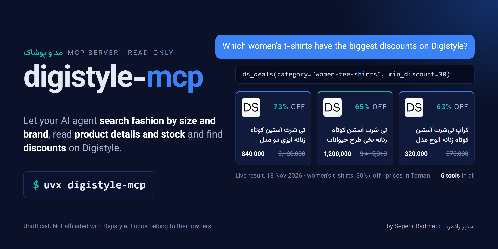

<!-- mcp-name: io.github.sepehr071/digistyle-mcp -->

<div align="center">



# digistyle-mcp: Digistyle (دیجی‌استایل) fashion store MCP server for AI agents

**digistyle-mcp is an unofficial, read-only MCP server that lets an AI agent search clothing and shoes, check sizes and stock, and find discounts on Digistyle (دیجی‌استایل, digistyle.com), Digikala's Iranian fashion store.**<br>
Its 6 tools search products with category, brand, size, color and price filters, show one product (price, discount, every size and color with stock, seller, specs, rating, comments), list categories, brands and the filters of a category, and find the biggest discounts.<br>
No API key or account is needed; it works in Claude, Cursor, Copilot and any other MCP client.

[](https://pypi.org/project/digistyle-mcp/)
[](https://pypi.org/project/digistyle-mcp/)
[](https://github.com/sepehr071/digistyle-mcp/actions/workflows/ci.yml)
[](https://github.com/sepehr071/digistyle-mcp/blob/main/LICENSE)

[For AI agents](#for-ai-agents) · [Quick start](#quick-start) · [Tools](#tools) · [Limits](#limits) · [فارسی](#فارسی)

</div>

---

## For AI agents

- **What:** unofficial MCP server (model context protocol) for digistyle.com: product search, product details with per-size stock, categories, brands, category filters and discounted products.
- **Install:** `uvx digistyle-mcp` or `claude mcp add digistyle -- uvx digistyle-mcp`. Transport: stdio. Needs [uv](https://docs.astral.sh/uv/getting-started/installation/) (Python 3.10+).
- **Auth:** none. Optional `DIGISTYLE_MCP_PROXY` (HTTP proxy URL, or a comma-separated list); system proxy settings are ignored.
- **Access:** read-only. It cannot log in, use a basket or favorites, order, pay or write reviews.
- **Tools:** 6, all prefixed `ds_`. Typical sequence: `ds_categories` -> `ds_filters` (exact size and color names) -> `ds_search`; `ds_search` -> `ds_product`; `ds_deals` for discounts.
- **Use when:** the user wants to find clothes or shoes in Iran, asks whether a size is in stock, compares prices of a brand, or looks for discounted fashion on Digistyle.
- **Output:** compact JSON. Prices are in Toman (the API sends Rial, already divided by 10), ratings are 0-5, `was` and `discount_percent` appear only on discounted products. Product titles and comments are Persian.

## Quick start

You need [uv](https://docs.astral.sh/uv/getting-started/installation/). No API key or account.

Claude Code:

```bash
claude mcp add digistyle -- uvx digistyle-mcp
```

Claude Desktop, Cursor, VS Code and other clients:

```json
{
  "mcpServers": {
    "digistyle": { "command": "uvx", "args": ["digistyle-mcp"] }
  }
}
```

Example prompts:

- "Which women's t-shirts on Digistyle have the biggest discounts?"
- "Find Adidas men's sports shoes in size 42, cheapest first."
- "Is this Digistyle product still in stock in size L?"
- <span dir="rtl">تی‌شرت‌های زنانه با بیشترین تخفیف در دیجی‌استایل کدام‌اند؟</span>
- <span dir="rtl">کفش ورزشی نایکی سایز ۴۲ زیر سه میلیون تومان پیدا کن.</span>

Real answer (18 Nov 2026): `ds_deals(category="women-tee-shirts", min_discount=30)` returned a t-shirt at 840,000 Toman instead of 3,120,000 (73% off), then 1,200,000 instead of 3,415,810 (65% off) and 320,000 instead of 870,000 (63% off).

## Tools

| Tool | What it returns |
|---|---|
| `ds_search` | Products by words, category, brand, size, color and price range, sorted by price, discount and more, paged |
| `ds_product` | One product: price, discount, every size and color with stock, seller, specs, rating, comments |
| `ds_categories` | Categories from the site menu with the code to use in the other tools |
| `ds_brands` | Brands (about 1700) with their code, searched by Persian or English name |
| `ds_filters` | What a category can be filtered by: sizes, colors, top brands, price range, attributes |
| `ds_deals` | Discounted products with the biggest discounts first, by category, brand or campaign |

## Limits

- Sizes and colors filter only in leaf categories (the deepest menu level); use `ds_categories` with `max_level=4` to find them.
- A few brands (Nike) are missing from the site's brand index; they are still found by their English code (`nike`) or Persian name.
- The site sort is not strictly ordered when discounts tie or prices differ per variant, so two neighbouring items can swap places, as on the site.
- Campaign pages under `/sales/` return 404 on the site and are not covered. Basket, favorites, orders, seller pages and anything behind a login are not covered.
- The site answers both Iranian and foreign networks in testing; if yours is blocked, set `DIGISTYLE_MCP_PROXY`. The server ignores system proxy variables on purpose.

## فارسی

<div dir="rtl">

**digistyle-mcp** یک سرور MCP غیررسمی و فقط‌خواندنی برای دیجی‌استایل (digistyle.com)، فروشگاه مد و پوشاک دیجی‌کالا است. با آن یک عامل هوش مصنوعی می‌تواند لباس و کفش را بر پایهٔ دسته، برند، سایز، رنگ و قیمت جست‌وجو کند، موجودی هر سایز و رنگ را ببیند، جزئیات کالا، دیدگاه‌ها و امتیاز را بخواند و کالاهای دارای بیشترین تخفیف را پیدا کند. قیمت‌ها به تومان است. بدون حساب کاربری و کلید API کار می‌کند. نصب در Claude Code:

</div>

```bash
claude mcp add digistyle -- uvx digistyle-mcp
```

## Development

```bash
uv sync
uv run ruff check . && uv run ruff format --check .
uv run python -m pytest -q          # offline tests on recorded fixtures
uv run python -m pytest -m live -q  # live calls to digistyle.com
```

Releases: bump the version in `pyproject.toml` and `server.json`, run `uv lock`, then push a `v*` tag; GitHub Actions publishes to PyPI.

## Disclaimer

Unofficial and not affiliated with or endorsed by Digistyle or Digikala. It is read-only and uses the public pages and API of digistyle.com, which can change without notice.

## Author

Built and maintained by **Sepehr Radmard** (سپهر رادمرد). [LinkedIn](https://www.linkedin.com/in/sepehr-radmard) · [GitHub](https://github.com/sepehr071) · more servers in [iran-mcp](https://github.com/sepehr071/iran-mcp).

## مجوز استفاده (License)

<a href="https://www.linkedin.com/in/sepehr-radmard"></a>

**استفادهٔ شخصی و غیرتجاری رایگان است.** استفاده در شرکت، محصول پولی یا پروژهٔ مشتری به مجوز تجاری نیاز دارد؛ از راه [لینکدین](https://www.linkedin.com/in/sepehr-radmard) یا [گیت&zwnj;هاب](https://github.com/sepehr071) با سپهر رادمرد تماس بگیرید. متن کامل: [PolyForm Noncommercial 1.0.0](https://github.com/sepehr071/digistyle-mcp/blob/main/LICENSE).

Free for personal and non-commercial use under the [PolyForm Noncommercial License 1.0.0](https://github.com/sepehr071/digistyle-mcp/blob/main/LICENSE). Using it in a company, a paid product or a client project needs a commercial license: contact Sepehr Radmard on [LinkedIn](https://www.linkedin.com/in/sepehr-radmard) or [GitHub](https://github.com/sepehr071).
